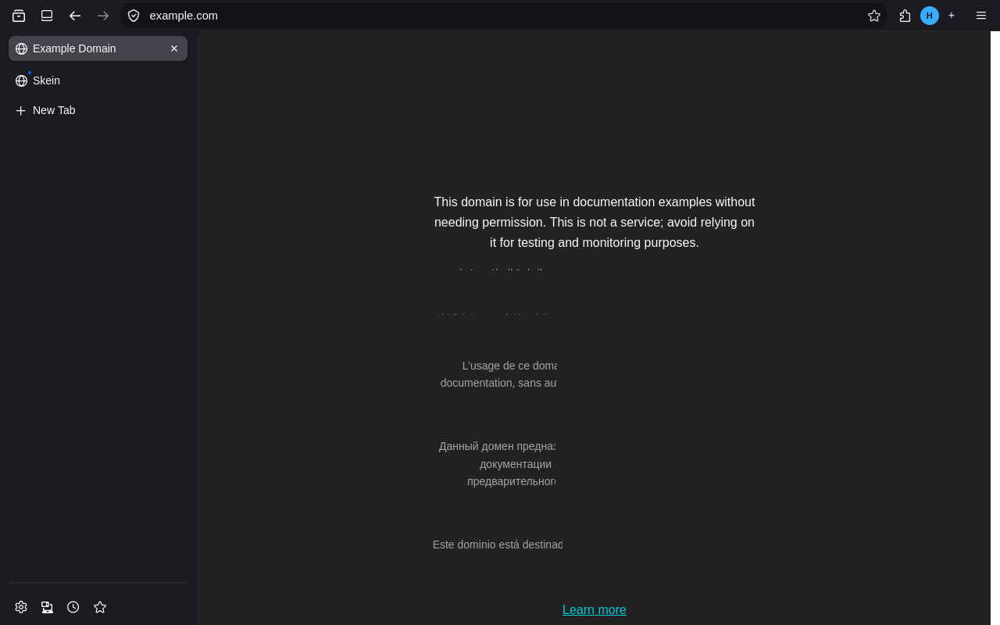
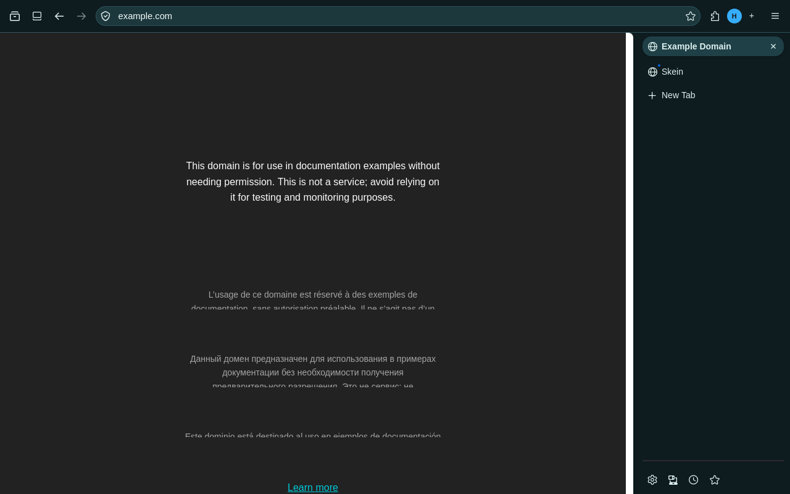

# Skein

**An open-source desktop browser on Gecko whose interface your own AI agent can safely customize.**

Tell your local coding agent "make the tabs vertical on the right with a dark
violet theme" and the browser changes, live. Don't like it? One click rolls it
back. Skein ships no built-in AI and has no AI accounts or keys: the agent is
yours (Claude Code or any other), and it works by editing a folder of plain
files that Skein validates before applying anything.

> **Status: pre-alpha.** Built and tested on Linux. Windows and macOS builds
> are not yet tested. Not affiliated with or endorsed by Mozilla.

Pronounced "skayn" (rhymes with "rain"): a length of thread. Freedom, with a line you control.

| Stock | After one request to an agent |
|---|---|
|  |  |

*"Give me a calm teal look, tabs on the right, and a roomier top bar."* The
agent wrote three small files; Skein validated and applied them in about a
second, without a restart. One click in `about:skein` puts it back.
Reproduce it: `python3 scripts/dev/demo.py`.

## What it does

- **Agent-customizable interface.** A documented customization folder
  (`skills/<id>/` with CSS, a structured layout file, allowlisted interface
  preferences and shortcuts). Skein generates a `SKILL.md` that teaches any
  agent the format and the rules.
- **A validator that fails closed.** No scripts, no remote loads, no page
  content. Nothing may hide, cover or imitate the address bar, site identity,
  permission prompts, download prompts or dialogs. After applying, a runtime
  integrity check inspects the live window and automatically undoes anything
  that slipped through.
- **Snapshots and rollback.** Every applied change is snapshotted. `about:skein`
  shows the diff and restores any earlier state. Safe mode starts with all
  skills off.
- **Spaces.** Switchable workspaces with their own tabs, optional per-space
  themes, and an optional container binding so a space's new tabs get separate
  cookies. Vertical tabs, tab groups (folders) and split view come from
  upstream Firefox.
- **Private by default.** Telemetry, studies, sponsored content and promotions
  are off. Strict tracking protection and HTTPS-only are on.
- **Privacy mode.** One switch. Hands off to the official Tor Browser, or, if
  you supply a SOCKS5 proxy, opens private windows that send everything
  (including DNS) through it with no direct fallback.

## What it does not do

- It does not sandbox your agent. An agent runs as you and can read your
  files. Give it access to the customization folder only; see
  [docs/hardened-agent-setup.md](docs/hardened-agent-setup.md).
- It does not make you anonymous. Privacy mode hides your IP address from
  sites; signing in still identifies you. For anonymity, use Tor Browser.
- Spaces organize tabs. They are not a security boundary; containers are.
- No sync service, no mobile apps, no extension store of its own.

## Focus features

- Zen-style layout: vertical tabs in a sidebar, page in a floating card.
  The sidebar has no search box: under the navigation buttons it shows only
  the padlock and the site you are on. Click it, press `Ctrl+L`, or press
  `Ctrl+T` and the real address bar floats over the page. The top of the
  window is only for bookmarks (`skein.ui.topSearchBar` brings the classic
  top bar back).
- Essentials: pinned tabs show as tiles at the top of the sidebar; drag a tab
  there to keep it. Spaces sit at the bottom of the sidebar, one dot per
  space, the active one filled.
- Compact mode (`Ctrl+Alt+C`): the whole sidebar slides away and comes back
  when you move the mouse to the left edge. `Ctrl+Alt+B` or the sidebar
  button does the same for the sidebar alone.
- New tab (`Ctrl+T` or the + button) floats the address bar, with the same
  autofill, history, bookmarks and search suggestions as `Ctrl+L`; what you
  pick opens in a new tab and Esc leaves things as they were. Turn off with
  `skein.focus.floatingNewTab`.
- Glance: right-click a link → Open in Glance to preview it in a floating
  card; Open as tab keeps it, Esc closes it.
- `Ctrl+Tab` switches to the most recently used tab; hold it to see all tabs.
- Closing the last tab keeps the window open on an empty home page.

Full list and what is next: [docs/zen-parity.md](docs/zen-parity.md).

## AI agents: the /skein skill

On start, Skein installs a `skein` skill into the AI coding agents it finds:
Claude Code (`~/.claude/skills`), Codex (`~/.codex/skills`), Antigravity
(`~/.gemini/config/skills`, legacy `~/.gemini/antigravity/skills`), Gemini CLI
(`~/.gemini/skills`), Cursor (`~/.cursor/skills`) and `~/.agents/skills`.
Ask your agent to "use /skein to make the tabs blue". Files you edit yourself
are never overwritten. Turn off with `skein.agentSkills.install`.

## Try it

There are no release downloads yet. Build from source:
[docs/build-linux.md](docs/build-linux.md) (tested),
[docs/build-windows.md](docs/build-windows.md).

Then open `about:skein`, copy the customization folder path, start your agent
in that folder and ask for a change.

## Project layout

| Path | What |
|---|---|
| `skein/` | Skein's source: an overlay of new files copied into the Firefox tree |
| `patches/`, `PATCHES.md` | The few edits to upstream Firefox files |
| `branding-src/` | Logo sources; `scripts/make-branding.sh` renders every icon from them |
| `mozconfigs/` | Build configurations (Linux, Windows, cross-compile, release) |
| `scripts/` | `apply.sh` (overlay + patches), `run.sh` (launch the dev build), `dev/` (tests, demo, benchmark) |
| `docs/`, `examples/` | Documentation and an example customization folder |
| `engine/`, `obj-*/` | Firefox checkout and build output. Not in git |

Run the build you just made with `scripts/run.sh`. Do not launch copies under
`obj-skein/dist/skein/` or the packaged archives: they are snapshots from the
last `mach package` and are out of date as soon as you rebuild. Each copy also
counts as a separate installation, so it opens its own profile.

## How it is built

Skein is a small layer on Firefox ESR: an overlay of new files plus a handful
of patches, listed in [PATCHES.md](PATCHES.md). No Zen Browser code is used.

- [docs/customization-format.md](docs/customization-format.md): the folder format
- [examples/](examples/): a complete example customization folder
- [docs/privacy-defaults.md](docs/privacy-defaults.md): what is off, and what still talks to the network
- [docs/phase0-report.md](docs/phase0-report.md): build pipeline, live-edit proof, timings
- [docs/release.md](docs/release.md): update and release process
- [SECURITY.md](SECURITY.md): reporting vulnerabilities, known limits
- [CONTRIBUTING.md](CONTRIBUTING.md)

## Licence

[MPL 2.0](LICENSE). Firefox source code is © Mozilla contributors under the
same licence. "Firefox" and "Mozilla" are trademarks of the Mozilla Foundation;
Skein does not use them as its name or branding.
